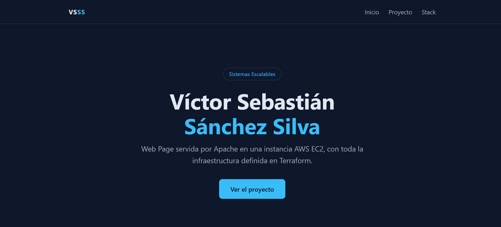

# Servidor web en AWS EC2 (capa gratuita) con Terraform

> Sistemas Escalables — ITESO
> Autor(es): Victor Sebastian Sanchez Silva
> Fecha: 2026-09-08

Despliega con Terraform una instancia EC2 `t2.micro` de la capa gratuita que instala **Apache (`httpd`)** al arrancar y publica una landing page. Es el punto de partida del lab: lo básico de Terraform y AWS, antes de pasar a Kubernetes en [`k3s_1`](../k3s_1).

---

## Tabla de contenidos
- [Objetivo](#objetivo)
- [Arquitectura](#arquitectura)
- [Tecnologías](#tecnologías)
- [Requisitos previos](#requisitos-previos)
- [Estructura del proyecto](#estructura-del-proyecto)
- [Configuración](#configuración)
- [Despliegue / Ejecución](#despliegue--ejecución)
- [Verificación](#verificación)
- [Resultados](#resultados)
- [Limpieza de recursos](#limpieza-de-recursos)
- [Problemas conocidos](#problemas-conocidos)
- [Referencias](#referencias)

---

## Objetivo
Lanzar una instancia EC2 y desplegar un WebServer simple, todo con Terraform y sin pasos manuales en la consola de AWS.

- Crear el Security Group y la instancia EC2 con Terraform.
- Instalar y arrancar Apache automáticamente con `user_data`.
- Servir una landing page que muestre los datos de la instancia que la atiende.
- Poder entrar a la instancia por SSH para revisar y hacer troubleshooting.
- Poder destruir y recrear el entorno en cada sesión sin dejar recursos.

## Arquitectura
Terraform crea el Security Group y la instancia. Al arrancar, la instancia ejecuta `user_data.sh`, que instala Apache, copia la landing page a `/var/www/html` y rellena los datos de la instancia (ID, zona, IP privada y tipo) leyéndolos del servicio de metadatos (IMDSv2).

```
                          ┌──────── EC2 (t2.micro) ────────┐
Navegador ── HTTP :80 ──► │ Security Group ──► Apache httpd │
                          │          Amazon Linux 2023      │
SSH :22 ────────────────► │ (llave generada por Terraform)  │
                          └─────────────────────────────────┘
```

Recursos que crea Terraform:
- **Key Pair** generado automáticamente; el `.pem` se guarda en `infra/` con permisos restringidos a tu usuario.
- **Security Group** `web-server-sg`: puertos 80 (HTTP) y 22 (SSH) abiertos a internet. El SSH solo entra con la llave `.pem`.
- **Instancia EC2** `t2.micro` con la AMI más reciente de Amazon Linux 2023, en la VPC por defecto.

## Tecnologías
| Herramienta | Versión | Uso |
|-------------|---------|-----|
| Terraform | — | Infraestructura como código |
| AWS provider | >= 5.0 | Recursos de AWS (EC2, Security Group, Key Pair) |
| tls / local providers | 4.x / 2.x | Generar la llave SSH y guardar el `.pem` |
| AWS EC2 | Amazon Linux 2023 | Servidor web (`t2.micro`, capa gratuita) |
| Apache httpd | repositorio de AL2023 | WebServer |
| Git Bash | — | Terminal para correr Terraform y SSH |

## Requisitos previos
- Terraform instalado (`terraform --version`).
- AWS CLI configurado con el perfil `academy` (`aws sts get-caller-identity --profile academy`).
  Si no lo tienes: `aws configure --profile academy`.
- **Bash**: en Windows, [Git Bash](https://git-scm.com/downloads); en Linux o Mac, la terminal normal. Los pasos automáticos de permisos del `.pem` y de limpieza de `known_hosts` usan `bash`.
- En Windows, **corre Terraform desde Git Bash**, no desde PowerShell ni CMD, para que `bash` apunte al de Git y no al de WSL.

## Estructura del proyecto
```
AWS_1/
├── infra/
│   ├── main.tf            # Provider, Security Group, Key Pair, EC2 y provisioners
│   ├── variables.tf       # Variables configurables
│   └── outputs.tf         # IP, URL y comando SSH
├── scripts/
│   └── user_data.sh       # Instala Apache y publica la landing page al arrancar
├── src/
│   ├── index.html         # Landing page que sirve Apache
│   └── styles.css         # Estilos de la landing page
└── README.md
```

## Configuración
Todas las variables tienen valor por defecto, así que no hace falta un archivo `.tfvars`.

| Variable | Descripción | Valor por defecto |
|----------|-------------|-------------------|
| `aws_profile` | Perfil de AWS CLI | `academy` |
| `aws_region` | Región de AWS | `us-east-1` |
| `instance_type` | Tipo de instancia EC2 | `t2.micro` |
| `allowed_ssh_cidr` | Rango de IPs con acceso SSH | `0.0.0.0/0` |
| `project_name` | Prefijo para nombrar los recursos | `web-server` |

Para cambiar un valor:
```bash
terraform apply -var="instance_type=t3.micro"
```

Para modificar la página, edita `src/index.html` o `src/styles.css` y corre `terraform apply`. Terraform la inyecta en `user_data.sh` con `templatefile()`, y como `user_data_replace_on_change = true`, recrea la instancia para que el cambio se aplique (la IP cambiará).

La página usa estos marcadores, que `user_data.sh` reemplaza con los metadatos de la instancia:

| Marcador | Se reemplaza por |
|----------|------------------|
| `__INSTANCE_ID__` | ID de la instancia |
| `__AZ__` | Zona de disponibilidad |
| `__PRIVATE_IP__` | IP privada |
| `__INSTANCE_TYPE__` | Tipo de instancia |

## Despliegue / Ejecución
```bash
# 1. Entrar a la carpeta de Terraform
cd AWS_1/infra

# 2. Inicializar (descarga el provider de AWS)
terraform init

# 3. (Opcional) Revisar qué se va a crear
terraform plan

# 4. Desplegar (confirma con yes)
terraform apply
```

Al terminar, Terraform muestra tres outputs:

```
public_ip   = "<IP_PUBLICA>"
ssh_command = "ssh -i C:/.../infra/web-server-key.pem ec2-user@<IP_PUBLICA>"
website_url = "http://<IP_PUBLICA>"
```

> Apache tarda **1 a 2 minutos** extra en instalarse después de que la instancia aparece como creada. Si el enlace no responde de inmediato, espera y recarga.

### Conectarse por SSH
Copia el texto de `ssh_command` (sin las comillas exteriores) y pégalo en Git Bash. O ejecútalo directamente desde `infra/`:

```bash
eval "$(terraform output -raw ssh_command)"
```

La primera vez te preguntará si confías en el servidor; responde `yes`.

## Verificación
Corre los pasos 0 a 2 **dentro de la instancia**, después de entrar por SSH, y el 3 desde tu computadora.

**0. Ver el progreso de la instalación** (útil justo después del `apply`; sal con `Ctrl + C`)
```bash
sudo tail -f /var/log/cloud-init-output.log
```

**1. Que Apache esté corriendo**
```bash
sudo systemctl status httpd --no-pager
```

**2. Que el puerto 80 responda en la instancia**
```bash
curl -v http://localhost
```

**3. Desde tu computadora**

```bash
curl http://<IP_PUBLICA>
```

Resultado esperado (pasos 2 y 3): el HTML de la landing page, que empieza así:
```
<!DOCTYPE html>
<html lang="es">
<head>
  <meta charset="UTF-8">
  ...
  <title>Víctor Sebastián Sánchez Silva | Web Page</title>
```

| Resultado | Dónde está el problema |
|---|---|
| Falla el paso 1 | Instalación de Apache (revisar el paso 0) |
| Pasa el 2, falla el 3 | Red de AWS (Security Group) |

En el navegador, la sección **Sobre este proyecto** debe mostrar el ID, la zona, la IP privada y el tipo de la instancia (no los marcadores `__INSTANCE_ID__`, etc.).

## Resultados
<!-- Agrega aquí tus capturas en docs/ y tus conclusiones -->



- Con un solo `terraform apply` queda un servidor web funcional en la capa gratuita, sin entrar a la consola.
- La página se versiona en `src/` y se despliega igual en cada recreación, porque la configuración vive en `user_data.sh`.

## Limpieza de recursos
Al terminar cada sesión, desde `infra/`:

```bash
terraform destroy
```

Confirma con `yes`. Esto borra la instancia, el Security Group, el Key Pair y el `.pem` local, y elimina la huella de la IP en `~/.ssh/known_hosts`.

Opcional, para no dejar rastro de la llave privada en el respaldo del state ni huellas viejas:
```bash
rm -f terraform.tfstate.backup ~/.ssh/known_hosts.old
```

## Problemas conocidos
| Problema | Causa | Solución |
|----------|-------|----------|
| El navegador no carga justo después del `apply` | `user_data.sh` sigue instalando Apache | Esperar 1 a 2 minutos y recargar |
| La página muestra `__INSTANCE_ID__` en lugar del ID | No se pudo leer el servicio de metadatos al arrancar | Revisar `/var/log/cloud-init-output.log` en la instancia |
| `UNPROTECTED PRIVATE KEY FILE` / `bad permissions` en Windows | El `.pem` hereda permisos de la carpeta y `file_permission` no aplica en NTFS | Provisioner que aplica `icacls` para dejar solo a tu usuario |
| `Identity file ... not accessible: No such file or directory` | Correr `ssh` desde otra carpeta o copiar el comando con comillas escapadas (`\"`) | El output usa la ruta absoluta sin comillas; o usar `terraform output -raw ssh_command` |
| Aviso `post-quantum key exchange` al conectar | El cliente SSH de Git Bash es más nuevo que el servidor de Amazon Linux | Es solo un aviso; se puede ignorar |
| `description doesn't comply with restrictions` al crear el Security Group | AWS no acepta acentos ni ñ en las descripciones de reglas | Escribir las descripciones sin acentos |

## Referencias
- [Terraform AWS Provider](https://registry.terraform.io/providers/hashicorp/aws/latest/docs)
- [EC2 user data](https://docs.aws.amazon.com/AWSEC2/latest/UserGuide/user-data.html)
- [Metadatos de instancia (IMDSv2)](https://docs.aws.amazon.com/AWSEC2/latest/UserGuide/configuring-instance-metadata-service.html)
- [Apache HTTP Server](https://httpd.apache.org/docs/)

---

**Notas**
- No subas a Git el `.pem` ni los archivos `terraform.tfstate*`: el state contiene la llave privada. Ya están en el `.gitignore` del lab.
- Si te conectas desde una ruta con espacios, usa `terraform output -raw ssh_command` o pon la ruta del `.pem` entre comillas.
