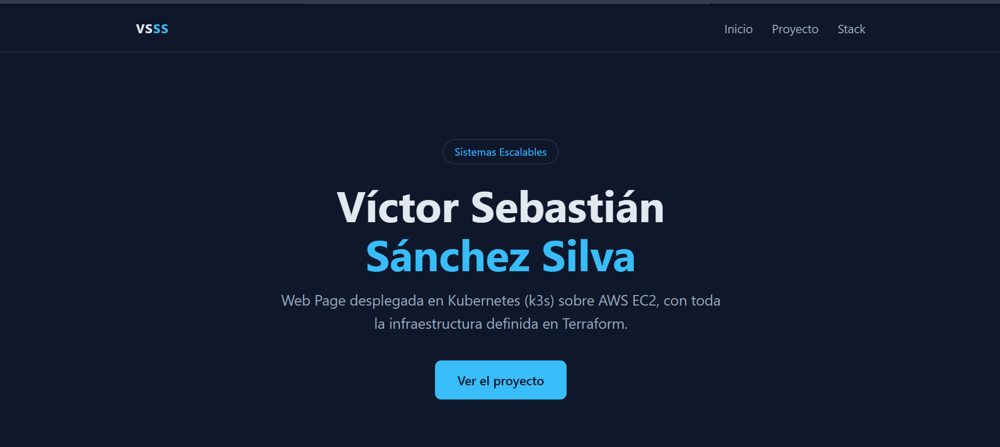
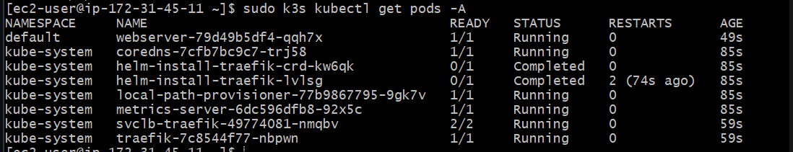

# EC2 + k3s + Traefik + WebServer con Terraform

> Sistemas Escalables — ITESO
> Autor(es): Victor Sebastian Sanchez Silva
> Fecha: 2026-09-12

Despliega con Terraform una instancia EC2 que instala **k3s** al arrancar y publica un **WebServer (nginx)** mediante un **Ingress** atendido por **Traefik**. El objetivo es practicar Kubernetes en un entorno de nube real, sin correr k3s en local.

---

## Tabla de contenidos
- [Objetivo](#objetivo)
- [Arquitectura](#arquitectura)
- [Tecnologías](#tecnologías)
- [Requisitos previos](#requisitos-previos)
- [Estructura del proyecto](#estructura-del-proyecto)
- [Configuración](#configuración)
- [Despliegue / Ejecución](#despliegue--ejecución)
- [Verificación](#verificación)
- [Resultados](#resultados)
- [Limpieza de recursos](#limpieza-de-recursos)
- [Problemas conocidos](#problemas-conocidos)
- [Referencias](#referencias)

---

## Objetivo
Lanzar una instancia EC2, desplegar un WebServer simple y conectarse a ella, todo con Terraform, usando k3s sobre EC2 en lugar de una instalación local.

- Crear toda la infraestructura (red, llave SSH, instancia) con Terraform, sin pasos manuales en la consola de AWS.
- Instalar k3s automáticamente y exponer nginx con un Ingress de Traefik, como se haría en producción.
- Conectarse por SSH de forma segura, permitiendo solo la IP pública de quien despliega.
- Poder destruir y recrear el entorno en cada sesión sin dejar rastros.

## Arquitectura
Terraform crea la infraestructura en AWS. Al arrancar, la instancia ejecuta `user_data.sh`, que instala k3s (con Traefik incluido) y aplica los manifiestos de nginx. El tráfico HTTP entra por el puerto 80 a Traefik, que lo enruta según el Ingress hacia el Service y el pod de nginx.

```
                          ┌──────────────────── EC2 (t3.small) ─────────────────────┐
Navegador ── HTTP :80 ──► │ Traefik ──► Ingress ──► Service (ClusterIP) ──► Pod nginx │
                          │                       k3s                                 │
Tu PC ───── SSH :22 ────► │ (solo tu IP /32)                                          │
                          └───────────────────────────────────────────────────────────┘
```

Recursos que crea Terraform:
- **Key Pair** generado automáticamente; el `.pem` se guarda en `infra/` con permisos restringidos a tu usuario.
- **Security Group**: puerto 80 abierto a internet; puertos 22 (SSH) y 6443 (API de k3s) solo para tu IP pública, detectada en cada `apply`.
- **Instancia EC2** en una zona de disponibilidad que soporte el tipo de instancia (se elige sola).

## Tecnologías
| Herramienta | Versión | Uso |
|-------------|---------|-----|
| Terraform | >= 1.3 | Infraestructura como código |
| AWS provider | 5.x | Recursos de AWS (EC2, Security Group, Key Pair) |
| tls / local / http providers | 4.x / 2.x / 3.x | Generar la llave SSH, guardar el `.pem` y detectar tu IP |
| AWS EC2 | Amazon Linux 2023 | Servidor donde corre k3s |
| k3s | canal stable | Kubernetes ligero de un solo nodo |
| Traefik | incluido en k3s | Ingress Controller |
| nginx | `stable-alpine` | WebServer |
| Git Bash | — | Terminal para correr Terraform y SSH |

## Requisitos previos
- Terraform instalado (`terraform --version`).
- AWS CLI configurado con el perfil `academy` (`aws sts get-caller-identity --profile academy`).
- **Bash**: en Windows, [Git Bash](https://git-scm.com/downloads); en Linux o Mac, la terminal normal. Los pasos automáticos de permisos del `.pem` y de limpieza de `known_hosts` usan `bash`.
- En Windows, **corre Terraform desde Git Bash**, no desde PowerShell ni CMD, para que `bash` apunte al de Git y no al de WSL.

## Estructura del proyecto
```
k3s_1/
├── infra/                 # Código Terraform (aquí se corren los comandos)
│   ├── main.tf            # Red, Security Group, Key Pair, EC2 y provisioners
│   ├── variables.tf       # Variables configurables
│   └── outputs.tf         # Comando SSH y URL del WebServer
├── scripts/
│   └── user_data.sh       # Instala k3s + Traefik y despliega nginx al arrancar
├── src/
│   ├── index.html         # Landing page que sirve nginx
│   └── styles.css         # Estilos de la landing page
├── docs/
│   ├── pods.png           # Evidencia: pods corriendo en k3s
│   └── webserver.png      # Evidencia: landing page en el navegador
└── README.md
```

## Configuración
Todas las variables tienen valor por defecto, así que no hace falta un archivo `.tfvars`.

| Variable | Descripción | Valor por defecto |
|----------|-------------|-------------------|
| `aws_profile` | Perfil de AWS CLI | `academy` |
| `aws_region` | Región de AWS | `us-east-1` |
| `instance_type` | Tipo de instancia EC2 | `t3.small` |
| `allowed_ssh_cidr` | IP autorizada para SSH y la API de k3s. Si es `null`, se detecta tu IP pública y se usa `/32` | `null` |
| `project_name` | Prefijo para nombrar los recursos | `k3s-webserver` |

Para modificar la página, edita `src/index.html` o `src/styles.css` y corre `terraform apply`. Terraform la inyecta en `user_data.sh` con `templatefile()`, y como `user_data_replace_on_change = true`, recrea la instancia para que el cambio se aplique (la IP cambiará).

Para cambiar un valor:
```bash
terraform apply -var="instance_type=t3.medium"
```

## Despliegue / Ejecución
```bash
# 1. Entrar a la carpeta de Terraform
cd k3s_1/infra

# 2. Inicializar (descarga los providers)
terraform init

# 3. Desplegar
terraform apply
```

Al terminar, Terraform muestra dos outputs:

```
ssh_command   = "ssh -i C:/.../infra/k3s-webserver-key.pem ec2-user@<IP_PUBLICA>"
webserver_url = "http://<IP_PUBLICA>"
```

> La instancia tarda **3 a 5 minutos** en quedar lista después del `apply`, mientras `user_data.sh` instala k3s y Traefik. Si ves "connection refused" en ese tiempo, es normal: espera y vuelve a intentar.

### Conectarse por SSH
Copia el texto de `ssh_command` (sin las comillas exteriores) y pégalo en Git Bash. O ejecútalo directamente desde `infra/`:

```bash
eval "$(terraform output -raw ssh_command)"
```

La primera vez te preguntará si confías en el servidor; responde `yes`.

## Verificación
Corre estos comandos **dentro de la instancia**, después de entrar por SSH. Van por capas, de adentro hacia afuera, para saber exactamente dónde falla algo.

**0. Ver el progreso de la instalación** (útil justo después del `apply`; sal con `Ctrl + C`)
```bash
sudo tail -f /var/log/cloud-init-output.log
```

**1. Que k3s esté vivo** (el nodo debe aparecer en `Ready`)
```bash
sudo systemctl status k3s --no-pager
sudo k3s kubectl get nodes
```

**2. Que los pods estén corriendo** (`webserver-...`, `traefik-...` y `svclb-traefik-...` en `Running`)
```bash
sudo k3s kubectl get pods -A
```

**3. Que nginx responda dentro del clúster, sin Traefik**
```bash
sudo k3s kubectl run test --rm -it --image=busybox --restart=Never -- wget -qO- http://webserver
```

**4. Que Traefik y el Ingress estén configurados**
```bash
sudo k3s kubectl get ingress
sudo k3s kubectl get svc -n kube-system traefik
```

**5. Que el puerto 80 responda en la instancia**
```bash
curl -v http://localhost
```

**6. Desde tu computadora**
```bash
curl http://<IP_PUBLICA>
```

Resultado esperado (pasos 3, 5 y 6): el HTML de la landing page, que empieza así:
```
<!DOCTYPE html>
<html lang="es">
<head>
  <meta charset="UTF-8">
  ...
  <title>Víctor Sebastián Sánchez Silva | Web Page</title>
```

| Resultado | Dónde está el problema |
|---|---|
| Falla el paso 3 | Pod o Service de nginx |
| Pasa el 3, falla el 5 | Traefik o el Ingress |
| Pasa el 5, falla el 6 | Red de AWS (Security Group) |

## Resultados
<!-- Agrega aquí tus capturas en docs/ y tus conclusiones -->





- k3s queda listo en pocos minutos sobre una `t3.small`, con Traefik incluido y sin configuración extra.
- Todo el entorno se reconstruye idéntico con `terraform apply`, porque la configuración interna vive en `user_data.sh` y no en pasos manuales.

## Limpieza de recursos
Al terminar cada sesión, desde `infra/`:

```bash
terraform destroy
```

Esto borra la instancia, el Security Group, el Key Pair y el `.pem` local, y elimina la huella de la IP en `~/.ssh/known_hosts`.

Opcional, para no dejar rastro de la llave privada en el respaldo del state ni huellas viejas:
```bash
rm -f terraform.tfstate.backup ~/.ssh/known_hosts.old
```

## Problemas conocidos
| Problema | Causa | Solución |
|----------|-------|----------|
| `description doesn't comply with restrictions` al crear el Security Group | AWS no acepta acentos ni ñ en las descripciones de reglas | Escribir las descripciones sin acentos |
| `Volume of size 20GB is smaller than snapshot` | El filtro de AMI era muy amplio y tomaba la variante para ECS (30 GB) | Filtrar solo `al2023-ami-2023.*-kernel-6.1-x86_64` |
| `instance type (t3.small) is not supported in us-east-1e` | `us-east-1e` no ofrece la familia `t3` | Elegir la subnet solo entre zonas que soportan el tipo de instancia (`aws_ec2_instance_type_offerings`) |
| `UNPROTECTED PRIVATE KEY FILE` / `bad permissions` en Windows | El `.pem` hereda permisos de la carpeta y `file_permission` no aplica en NTFS | Provisioner que aplica `icacls` para dejar solo a tu usuario |
| `Access is denied` al recrear el `.pem` | `file_permission = "0400"` marcaba el archivo como solo lectura en Windows | Usar `0600` y dar `(F)` a tu usuario con `icacls` |
| `Identity file ... not accessible: No such file or directory` | Correr `ssh` desde otra carpeta o copiar el comando con comillas escapadas (`\"`) | El output usa la ruta absoluta sin comillas; o usar `terraform output -raw ssh_command` |
| `connection refused` justo después del `apply` | `user_data.sh` sigue instalando k3s y Traefik | Esperar de 3 a 5 minutos y revisar `/var/log/cloud-init-output.log` |
| Aviso `post-quantum key exchange` al conectar | El cliente SSH de Git Bash es más nuevo que el servidor de Amazon Linux | Es solo un aviso; se puede ignorar |

## Referencias
- [Documentación de k3s](https://docs.k3s.io/)
- [Traefik y k3s (networking)](https://docs.k3s.io/networking/networking-services)
- [Terraform AWS Provider](https://registry.terraform.io/providers/hashicorp/aws/latest/docs)
- [Kubernetes Ingress](https://kubernetes.io/docs/concepts/services-networking/ingress/)
- [EC2 user data](https://docs.aws.amazon.com/AWSEC2/latest/UserGuide/user-data.html)

---

**Notas**
- No subas a Git el `.pem` ni los archivos `terraform.tfstate*`: el state contiene la llave privada. Ya están en el `.gitignore` del lab.
- El output `ssh_command` no lleva comillas alrededor de la ruta, así que si mueves el proyecto a una ruta con espacios, usa `terraform output -raw ssh_command` o pon la ruta entre comillas manualmente.
